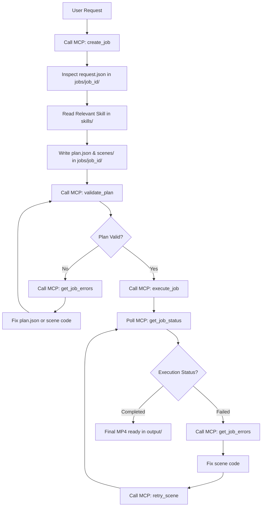

# External AI Director Generation Workflow

This document defines the operating instructions for external AI coding agents (such as Codex or Antigravity) acting as the **External LLM Director** for the AI Video Generation Pipeline.

---

## 1. Architectural Role

You (the AI Agent) are the **LLM Director**.
The Python backend contains **no internal LLM APIs, no paid AI services, and no background AI agents**.

Your responsibilities:
1. Interpret user requests for video generation.
2. Select appropriate animation technology automatically based on video category.
3. Read the relevant specialized skill document from `skills/`.
4. Generate structured job files (`plan.json`, scene code, audio plans) in the job directory.
5. Invoke local MCP tools to validate, execute, monitor, and repair scenes.

---

## 2. Supported Categories & Technology Selection

You must automatically choose the animation engine based on the user's requested video category without asking the user:

| Category | Typical Topic | Target Engine | Skill Reference |
|---|---|---|---|
| **Kids' Animated Stories** | Fairy tales, animal fables, moral lessons | **Blender** (3D stylized) or **Three.js + Remotion** (2D/3D cutouts) | `skills/kids_stories.md` |
| **General Explanatory** | Business concepts, science overviews, tech explainers | **Three.js + GSAP + Remotion** (motion graphics, cards, UI) | `skills/explanatory_videos.md` |
| **CS & Mathematics** | Algorithms, calculus, linear algebra, data structures | **Manim** (Community Edition) | `skills/cs_math_videos.md` |

Hybrid approaches (e.g. Manim for mathematical proofs followed by Remotion for an infographic summary) are supported and planned scene-by-scene.

---

## 3. Standard Generation Workflow

Follow this step-by-step lifecycle for every video generation request:



### Step 1: Initialize Job
Call the MCP tool `create_job`:
```json
{
  "video_type": "cs_math_educational",
  "topic_or_prompt": "Visualizing Dijkstra Algorithm on a 6-node graph",
  "target_duration_seconds": 60.0,
  "language": "en",
  "aspect_ratio": "16:9"
}
```
This initializes the workspace at `jobs/<job_id>/`.

### Step 2: Plan and Author Content
In `jobs/<job_id>/`:
- Write `plan.json` defining the global metadata, shared timeline, narration, captions, SFX, and scene breakdown.
- For each scene, create its dedicated code file under `jobs/<job_id>/scenes/scene_<index>/`:
  - For Manim: `scene.py`
  - For Blender: `scene.py`
  - For Three.js / Remotion: `Scene.tsx`

### Step 3: Validate the Plan
Call `validate_plan(job_id="<job_id>")`.
- If `is_valid` is `false`, call `get_job_errors(job_id="<job_id>")`.
- Inspect syntax errors, missing asset references, or timing discrepancies.
- Correct the files locally and re-run `validate_plan`.

### Step 4: Execute Job
Call `execute_job(job_id="<job_id>")`.
The deterministic Python engine runs:
- **Parser Ω**: Ingests your animation scripts and sets up renderer scenes.
- **Parser θ**: Ingests your sound/music/edit cues and binds them to the shared timeline.
- **TTS Service**: Generates narration and extracts precise word timestamps.
- **Text Splash**: Generates synchronized animated captions.
- **Renderer**: Renders scenes via headless engines.
- **Compositor**: Merges visuals, voiceover, sound effects, BGM, and subtitles into the final MP4.

### Step 5: Handle Failures and Repair
If rendering or quality validation fails:
1. Call `get_job_errors(job_id="<job_id>")`.
2. Locate the failing scene(s).
3. Modify only the failing scene code in `jobs/<job_id>/scenes/<failing_scene>/`.
4. Call `retry_scene(job_id="<job_id>", scene_id="<failing_scene>")`.
5. Only the repaired scene is re-rendered and re-composed.

---

## 4. Shared Timeline Specification

All modalities share one global timeline (`0.00s` to `target_duration_seconds`):
- **Visuals**: Each scene defines continuous, non-overlapping `[start_time, end_time]`.
- **Narration**: Voiceover segments must fit within the corresponding scene interval.
- **Captions**: Word/phrase splashes align with narration timestamps.
- **Sound Effects (SFX)**: Positioned at exact timestamp markers (e.g. collision at `14.2s`).
- **Background Music (BGM)**: Defines track intervals, volume levels, and ducking periods during speech.

---

## 5. Job Directory Structure

```text
jobs/<job_id>/
├── request.json          # Input parameters (from create_job)
├── plan.json             # AI-generated plan conforming to PlanManifest schema
├── status.json           # Job status maintained by Python pipeline
├── errors.json           # Detailed error logs if validation or render fails
├── scenes/
│   ├── scene_01/
│   │   ├── scene.py      # Animation code (Manim/Blender) or Scene.tsx (Remotion)
│   │   └── assets.json   # Optional asset dependencies
│   └── scene_02/
│       └── scene.py
└── output/
    ├── scenes/           # Rendered scene video files
    ├── audio/            # Narration and mixed audio stems
    └── final_video.mp4   # Final compiled video
```
